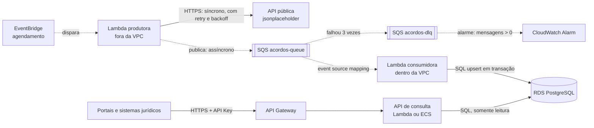
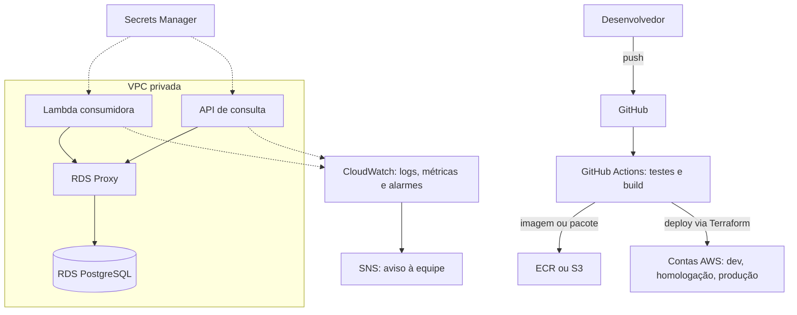

# Arquitetura da solução (AWS)

## Visão geral

Linhas tracejadas são integrações **assíncronas**; linhas contínuas são **síncronas**.

## Síncrono × assíncrono

| Integração | Tipo | Por quê |
|---|---|---|
| EventBridge → produtora | Assíncrono | Disparo por evento |
| Produtora → API pública | Síncrono | Precisa da resposta; tem timeout, retry e backoff |
| Produtora → SQS | Assíncrono | Desacopla coleta e gravação |
| SQS → consumidora | Assíncrono | A AWS faz o polling e entrega lotes |
| Consumidora → RDS | Síncrono | Transação: só confirma se gravou |
| Portais → API → RDS | Síncrono | Quem consulta espera a resposta |

## Componentes

**Ingestão.** Uma Lambda agendada pelo EventBridge consulta a API pública (com timeout e retentativa com backoff exponencial e jitter) e publica uma mensagem por autor, contendo seus acordos e documentos. Fica fora da VPC: só precisa de internet e do SQS, e assim evita o custo de um NAT Gateway.

**Mensageria.** Fila SQS Standard com DLQ. Visibility timeout de 30 s e `maxReceiveCount = 3`. Standard (e não FIFO) porque a ordem não importa, cada mensagem é um autor independente, e a entrega "pelo menos uma vez" é absorvida pela idempotência do consumidor. Após 3 recebimentos sem sucesso, o próprio SQS move a mensagem para a DLQ, onde fica preservada para análise e reprocessamento. O visibility timeout da fila deve ser maior que o timeout da Lambda consumidora (a recomendação da AWS é de pelo menos seis vezes).

**Persistência.** RDS PostgreSQL Multi-AZ em subnet privada, criptografado em repouso (KMS). O consumidor grava com `INSERT ... ON CONFLICT DO UPDATE`, na ordem autor → acordos → documentos, dentro de uma transação. Isso torna a carga idempotente: reprocessar não duplica.

**Exposição.** API REST de leitura, protegida por API Key, em camadas (controller, serviço, repositório). Pode rodar em Lambda atrás do API Gateway ou em container no ECS Fargate atrás de um ALB. O health check do ALB usa `/health/ready`. Em Lambda, usar RDS Proxy para não esgotar as conexões do banco.

## Por que banco relacional (e não NoSQL)

1. Os dados são relacionais (autor → acordos → documentos), com integridade garantida por chaves estrangeiras.
2. A gravação é transacional: autor, acordos e documentos entram juntos ou não entram.
3. As consultas são variadas (acordos por autor, ranking, acordos sem documentos) e naturais em SQL. No DynamoDB os padrões de acesso precisam ser conhecidos antes de modelar, e consultas novas viram `Scan` caros.
4. O volume é pequeno e moderado, sem necessidade de escala horizontal massiva.

Quando mudaria: se o único acesso fosse buscar tudo de um autor por id, com milhões de leituras por segundo e latência previsível, o DynamoDB passaria a fazer sentido.

## Lambda × ECS × EKS

| Critério | Lambda | ECS Fargate | EKS |
|---|---|---|---|
| Custo | Por execução; ótimo para carga esporádica, caro em tráfego alto e constante | Pelo tempo ligado, mesmo ocioso | O mais alto: control plane mais nós |
| Escalabilidade | Automática e rápida, de zero ao limite de concorrência | Boa, por políticas de escala | A mais flexível, com mais configuração |
| Operação | Mínima | Baixa | Alta; exige experiência em Kubernetes |
| Limitações | 15 min por execução, cold start, conexões por instância | Sem limite de tempo | Sem limite de tempo |
| Bom para | Jobs agendados e consumo de filas | API com tráfego constante, processos longos | Muitos serviços e portabilidade entre nuvens |

**Recomendação.** Produtora e consumidora em Lambda (esporádicas e dirigidas por evento). API em Lambda com RDS Proxy para começar, migrando para ECS Fargate se o tráfego ficar constante, se a latência precisar ser estável ou se o custo por requisição superar o de um container sempre ligado. EKS não se justifica para três componentes.

## Logs, segredos e pipeline

| Preocupação | Serviço | Observação |
|---|---|---|
| Logs | CloudWatch Logs | Os logs JSON em stdout são o formato esperado; o Logs Insights filtra por `correlation_id` |
| Segredos | Secrets Manager | Senha do banco e API Key; o código lê variáveis de ambiente e não muda |
| Pipeline | GitHub Actions + Terraform | Testes e build a cada push; deploy por infraestrutura como código |
| Alarmes | CloudWatch Alarms + SNS | Ver `docs/operacao-e-seguranca.md` |

## Local × produção

| Local (docker-compose) | AWS |
|---|---|
| `producer` (container sob demanda) | Lambda disparada pelo EventBridge |
| ElasticMQ | Amazon SQS, com a mesma `RedrivePolicy` |
| `consumer` (laço) | Lambda com event source mapping |
| PostgreSQL | RDS PostgreSQL Multi-AZ |
| `api` (uvicorn) | API Gateway + Lambda, ou ECS Fargate atrás de um ALB |
| `.env` | Secrets Manager |
| Logs em stdout | CloudWatch Logs |

O código usa `boto3` com um `endpoint_url` configurável: em produção a variável fica vazia e o mesmo código fala com a AWS real, sem alterar a lógica.

## Limites e trade-offs conhecidos

- A mensagem de um autor tem cerca de 80 KB, bem abaixo do limite de 256 KiB do SQS padrão. Com volumes maiores, a mensagem seria dividida por acordo.
- A Lambda tem teto de 15 minutos. A carga atual leva cerca de 2 segundos; para volumes maiores, o produtor publicaria só os ids e os consumidores buscariam os detalhes.
- O upsert só insere e atualiza; remoções na origem não são propagadas.
- A API Key única é suficiente para o case; JWT e escopos seriam o passo seguinte.
